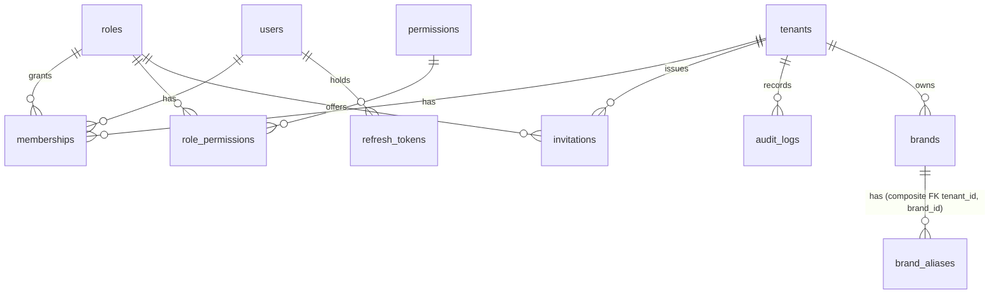

# Data model

Authoritative definition: `backend/migrations/versions/`. ORM mirror: `backend/app/db/models.py`.

## Milestone 1 tables

| Table | Scope | RLS rule (USING / WITH CHECK) |
|---|---|---|
| `tenants` | global row per org | select: current tenant or one you're a member of · write: current tenant |
| `users` | global | select: yourself or members of current tenant · write: yourself |
| `roles`, `permissions`, `role_permissions` | global, read-only to app | none (SELECT only grant) |
| `memberships` | tenant | select: current tenant **or** your own rows · write: current tenant |
| `refresh_tokens` | user | own rows |
| `invitations` | tenant | current tenant |
| `audit_logs` | tenant | current tenant; INSERT/SELECT only |
| `brands` | tenant | current tenant; unique `(tenant_id, lower(name))` |
| `brand_aliases` | tenant | current tenant; unique `(brand_id, lower(alias))`; `script ∈ latin/arabic/arabizi/tifinagh/other` |

Conventions: UUIDv4 primary keys, `timestamptz` everywhere, CHECK constraints for enumerations, JSONB only for `audit_logs.metadata`.

## Milestone 1.1 & 2 tables

| Table | Scope | Notes |
|---|---|---|
| `user_tokens`, `user_mfa`, `mfa_recovery_codes` | user | own-row RLS; tokens/codes stored as SHA-256, MFA secret Fernet-encrypted |
| `plans`, `plan_entitlements` | global, read-only to app | NULL entitlement = unlimited |
| `subscriptions` | tenant | one per tenant; app can read/insert, not change plan |
| `products`, `competitors` | tenant | composite FK to brand; `aliases text[]`; unique `(brand_id, lower(name))` |
| `brand_keywords` | tenant | `kind ∈ include/exclude`; unique `(brand_id, kind, lower(expression))` |
| `monitoring_projects` | tenant | frequency 15 min–7 days; `next_run_at` NULL when paused |
| `monitoring_runs` | tenant | `trigger ∈ schedule/manual`, `status ∈ queued/running/completed/skipped/failed`, `summary jsonb` |
| `jobs` | system | RLS forced, **no** policy or grant: reachable only via `enqueue_job`, `claim_jobs`, `complete_job`, `fail_job`, `requeue_stale_jobs`, `schedule_due_monitoring`, `job_stats` |

## Milestone 3 tables

| Table | Scope | Notes |
|---|---|---|
| `connector_policies` | global, read-only to app | compliance record per connector; `review_status` gates production |
| `sources` | tenant | `kind ∈ website/rss`, coverage state, discovery origin, error tracking; unique `(tenant_id, kind, lower(url))` |
| `mentions` | tenant | composite FKs to brand, project, source; unique `(tenant_id, brand_id, canonical_url)`; `content_hash` + `duplicate_of` for reposts; `original_text` excerpt never rewritten; `normalized_text`/`language` reserved for M4; `published_at` NULL when unknown + `published_at_source` (`page_metadata`, `feed`, `provider`, `provider_relative` = approximate) |

## Planned (per master prompt §14)

Added milestone by milestone, each with RLS + composite FKs + isolation tests:
source_health_checks / collection_events history, mention_entities (M5) · dialect_expressions, language_annotations, language_model_versions, language_evaluation_runs (M4) · mention_analysis, sentiment_history, trend_events, crisis_events, reputation_metrics, competitor_analysis, notifications, reports (M5) · browser_* , captcha_events, human_interventions (M6) · ai_tasks, ai_actions, agent_runs, approval_requests (M7) · invoices, usage metering (M8).

`mentions` will keep `original_text` immutable alongside `normalized_text`, `content_hash`, `source_url`, `collection_method`, `connector_version`, `published_at` (nullable — never invented) and `collected_at`.
