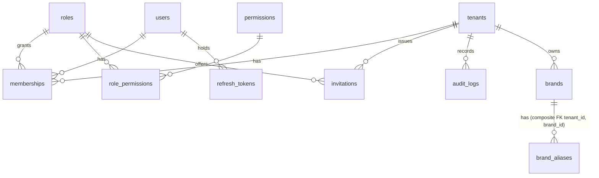

# Data model

Authoritative definition: `backend/migrations/versions/`. ORM mirror: `backend/app/db/models.py`.

## Milestone 1 tables

| Table | Scope | RLS rule (USING / WITH CHECK) |
|---|---|---|
| `tenants` | global row per org | select: current tenant or one you're a member of · write: current tenant |
| `users` | global | select: yourself or members of current tenant · write: yourself |
| `roles`, `permissions`, `role_permissions` | global, read-only to app | none (SELECT only grant) |
| `memberships` | tenant | select: current tenant **or** your own rows · write: current tenant |
| `refresh_tokens` | user | own rows |
| `invitations` | tenant | current tenant |
| `audit_logs` | tenant | current tenant; INSERT/SELECT only |
| `brands` | tenant | current tenant; unique `(tenant_id, lower(name))` |
| `brand_aliases` | tenant | current tenant; unique `(brand_id, lower(alias))`; `script ∈ latin/arabic/arabizi/tifinagh/other` |

Conventions: UUIDv4 primary keys, `timestamptz` everywhere, CHECK constraints for enumerations, JSONB only for `audit_logs.metadata`.

## Milestone 1.1 & 2 tables

| Table | Scope | Notes |
|---|---|---|
| `user_tokens`, `user_mfa`, `mfa_recovery_codes` | user | own-row RLS; tokens/codes stored as SHA-256, MFA secret Fernet-encrypted |
| `plans`, `plan_entitlements` | global, read-only to app | NULL entitlement = unlimited |
| `subscriptions` | tenant | one per tenant; app can read/insert, not change plan |
| `products`, `competitors` | tenant | composite FK to brand; `aliases text[]`; unique `(brand_id, lower(name))` |
| `brand_keywords` | tenant | `kind ∈ include/exclude`; unique `(brand_id, kind, lower(expression))` |
| `monitoring_projects` | tenant | frequency 15 min–7 days; `next_run_at` NULL when paused |
| `monitoring_runs` | tenant | `trigger ∈ schedule/manual`, `status ∈ queued/running/completed/skipped/failed`, `summary jsonb` |
| `jobs` | system | RLS forced, **no** policy or grant: reachable only via `enqueue_job`, `claim_jobs`, `complete_job`, `fail_job`, `requeue_stale_jobs`, `schedule_due_monitoring`, `job_stats` |

## Milestone 3 tables

| Table | Scope | Notes |
|---|---|---|
| `connector_policies` | global, read-only to app | compliance record per connector; `review_status` gates production |
| `sources` | tenant | `kind ∈ website/rss`, coverage state, discovery origin, error tracking; unique `(tenant_id, kind, lower(url))` |
| `mentions` | tenant | composite FKs to brand, project, source; unique `(tenant_id, brand_id, canonical_url)`; `content_hash` + `duplicate_of` for reposts; `original_text` excerpt never rewritten; `normalized_text`/`language` reserved for M4; `published_at` NULL when unknown + `published_at_source` (`page_metadata`, `feed`, `provider`, `provider_relative` = approximate) |

## Milestone 4 tables

| Table | Scope | Notes |
|---|---|---|
| `mention_analysis` | tenant | 1:1 with mention (composite FK); heuristic fields, final AI labels, agreement, all annotator outputs, versions; `corrected_*` beside AI labels |
| `language_annotations` | platform (admin-only RLS) | corpus/gold set; `auto_labels` vs human `labels`; `status`, `split` (gold_test/gold_dev/train); origin tenant (cascade + purge on opt-out) |
| `language_evaluation_runs` | platform | benchmark runs: models, prompt/analysis versions, metrics |
| `dialect_expressions` | platform, read-only | seed lexicon (`seed_unvalidated`) |
| `users.is_platform_admin`, `tenants.nlp_corpus_opt_in` | — | flag protected by trigger; opt-in per organization |

## Milestone 5 tables

| Table | Scope | Notes |
|---|---|---|
| `webhooks` | tenant | https-only URL (CHECK), Fernet-encrypted signing secret, last delivery status |
| `alert_rules` | tenant | `kind`, optional brand (composite FK), `params`, `min_severity`, `channels ⊂ {in_app,email,webhook}`, `notify_roles`, webhook (composite FK, SET NULL) |
| `alerts` | tenant | unique `(tenant_id, dedup_key)`; `status ∈ open/acknowledged/resolved`; `data` holds the measured facts |
| `crisis_events` | tenant | one active per brand (partial unique index); severity, peak, metrics, resolution |
| `trend_events` | tenant | emerging topics per brand and day (unique on `lower(topic)`) |
| `reports` | tenant | kind, period, format, locale, status, content (bytea), filename |

Daily sentiment and reputation figures are computed on demand from `mentions` + `mention_analysis` (single source of truth) — see `REPUTATION_METHODOLOGY.md`.

## Milestone 6 tables

| Table | Scope | Notes |
|---|---|---|
| `browser_workers` | platform (admin read) | heartbeats, capacity, metrics; written via `browser_worker_heartbeat()` |
| `browser_domain_policies` | platform, read-only | allowed, concurrency, spacing, timeout, skipped resource types; `*` default |
| `browser_domain_state` | platform (admin read) | cooldown after challenges, consecutive count, last visit (no tenant data) |
| `browser_missions` | tenant | 11 states (trigger-enforced), kind, priority, params, authorization record, result, attempts, deadline; composite FKs to mention (SET NULL) and source |
| `browser_sessions` | tenant | one per context: isolation settings, closed, cleanup verified, requests refused |
| `browser_session_events` | tenant | audit trail (transitions by trigger, validation, navigation, challenge, blocked requests, cleanup) |
| `captcha_events` | tenant | kind, confidence, signals, via http/browser, state history, response (cooldown, fallback) |
| `sources` + | tenant | `render_mode`, `challenge_count`, `last_challenge_kind/at` |
| `mentions` + | tenant | `verified_with` (`http`/`browser`), states `pending_render`, `blocked_by_challenge` |

## Milestone 7 tables

| Table | Scope | Notes |
|---|---|---|
| `ai_tasks` | tenant | kind / resolved kind, goal, brand, params, locale, status, plan, result (findings, step statuses, action counts), orchestrator version |
| `agent_runs` | tenant | one per step: agent + version, input, typed output, tools used, model calls / id / prompt version, status, error, duration |
| `ai_actions` | tenant | kind (allowlisted), validated params, rationale, risk, requires_approval, status, compliance record at proposal and execution, result |
| `approval_requests` | tenant | one per sensitive action; pending/approved/rejected/expired; decider must hold `ai:approve`; final once decided |
| `brands` + | tenant | `response_tone`, `response_guidelines` |

## 0.11 social sources (migration 0019)

| Table / column | Notes |
|---|---|
| `sources` + | social kinds (see SOCIAL_SOURCES) with `project_id` (required for them, forbidden for website/RSS), `match_mode` (`terms` / `brand`), `query`, `frequency_minutes`, `next_sync_at`, `last_synced_at`, `sync_state` (newest date collected, posts waiting for their comments, posts whose comments were fetched); uniqueness per project |
| `source_syncs` | one row per provider run: provider (`apify` / `youtube`), stage (`items` / `comments`), trigger, status, actor, run and dataset ids, max items, items read / unreadable, mentions new / known, results billed, API units, provider-reported cost, error category |
| `mentions` + | `platform`, `external_id` (unique per brand), `content_type` (`post`, `video`, `comment`, `reply`), `parent_mention_id` (same tenant, composite FK), `engagement` (as returned), `author_external_id`, `author_url`; methods `platform_api`, `third_party_provider`; verification `platform_api_record`, `provider_record` |
| usage metrics + | `facebook_posts`, `facebook_comments`, `tiktok_results`, `reddit_results`, `linkedin_results`, `youtube_results`, `youtube_units` |
| functions | `schedule_social_syncs(int)`, `youtube_units_today()` (platform-wide, number only) |

## Milestone 8 tables

| Table | Scope | Notes |
|---|---|---|
| `plans` + | global | `description`, `is_public`, `sort_order`; tiers starter → enterprise created inactive, without prices. Readable by all, writable by platform admins only |
| `plan_entitlements` + | global | new keys `max_mentions_per_month`, `max_ai_calls_per_month`, `max_reports_per_month`, `max_webhooks`, `max_concurrent_browser_missions`, `max_retention_days` (NULL = unlimited) |
| `plan_prices` | global | plan × currency × month/year, amount in minor units; replaced prices kept inactive (history) |
| `subscriptions` + | tenant | status adds `expired`; `billing_interval`, `currency`, `current_period_start`, `canceled_at`, `notes`; writable by platform admins only (trigger) |
| `billing_accounts` | tenant | legal name, address, RC, NIF, NIS, article d'imposition, VAT number, e-mail, currency |
| `invoices` | tenant | draft → issued → paid / void; number `PREFIX-YEAR-00001` assigned at issue (gapless, `invoice_counters`); seller and buyer snapshots; subtotal, VAT, stamp duty, total, amount in words; immutable once issued |
| `invoice_lines` | tenant | composite FK to the invoice; immutable once issued |
| `usage_events` | tenant | metric (`mentions_collected`, `search_queries`, `ai_calls`, `ai_tokens`, `browser_missions`, `reports_generated`, `agent_tasks`, `emails_sent`), quantity, reference; recorded in the same transaction as the work; monthly sums in Algiers time (`usage_this_month`) |
| `plan_change_requests` | tenant | one pending at a time; done / declined / cancelled |
| `connector_policies` + | global | `review_notes`; review recorded by platform admins |

## Scanner tables (migration 0010)

Isolated by Scanner account (`app.scanner_account_id`), never by tenant. See SCANNER.md.

| Table | Scope | Notes |
|---|---|---|
| `scanner_accounts` | own row | separate from `users`; one account type (email, name, locale) |
| `scanner_refresh_tokens` | account | hashed, rotated, family revocation |
| `scanner_collection_sessions` | account | 11 statuses; partial unique index = one open session (`draft/collecting/ready`) per account; `anypulse_collection_id` once acknowledged |
| `scanner_collection_items` | account | composite FK `(account_id, session_id)`; `source_type ∈ screenshot/url/import`; URL required for URL items |
| `scanner_audit_logs` | account | INSERT/SELECT only |

Migration 0011 (AynPulse access): `scanner_accounts.anypulse_access` (`active`/`revoked`), `access_revoked_at`, `access_revoked_by`, `access_revoke_reason`. Forced to `active` on INSERT (trigger); not updatable by the API role (column grants); changed only by `admin_scanner_set_access()` for platform administrators.

Migration 0012 (screenshots):

| Table | Scope | Notes |
|---|---|---|
| `scanner_uploaded_files` | account | one per screenshot item; `storage_key` (private object storage), sanitised `mime_type` (PNG/JPEG/WebP only), size, dimensions, `sha256` (unique per collection), `dhash`; composite FKs to the account's item and collection; SELECT/INSERT/DELETE only |
| `scanner_collection_items` + | account | `UNIQUE (account_id, id)`; `possible_duplicate_of` (composite FK to an item of the same account) |

Migration 0013 (built-in browser): `scanner_browser_profiles` (account, own row only) — `account_id` PK, `state_encrypted` (Fernet: cookies and local storage of the agent's built-in browser, never passwords), `updated_at`.

Migration 0014 (extraction): `scanner_extractions` (account, own rows only) — one per item: `status` (queued, running, done, failed), `model`, tokens, `captured_at`, `context` (page or group, dialog title, view), `issues`, `confidence`, `raw` (model output and prompt version), `error_code`. `scanner_extracted_entries` (account) — `kind` (post, comment, reply), `parent_id` and `duplicate_of` (composite FKs within the account), `author_name`, `author_is_page`, `text`, `image_text`, `script`, `text_truncated`, `partially_visible`, `relative_time`, `published_at` + `published_precision`, counters, `dedup_key`, `edited_by_agent`. The API role may update only `author_name`, `text` (agent corrections) and the links.

Migration 0015: `scanner_extractions.validated_at` — set when the agent validates the reading on the review screen; cleared when the screenshot is read again.

Migration 0016 (links): `scanner_collection_items.link_item_id` (capture taken from a pasted link; composite FK within the account, `ON DELETE SET NULL`), `url_key` (SHA-256 of the normalised address; required for `url` items, unique per collection).

Migration 0017 (retention): index on `scanner_uploaded_files.retention_until`; `scanner_retention_accounts(idle_days)` (SECURITY DEFINER, lists accounts with expired images or abandoned collections); the API role may update `retention_until` only.

Migration 0018 (sending): `mentions.collection_method` accepts `scanner`, `verification_status` accepts `scanner_validated` / `scanner_unvalidated`; connector policy `aynpulse_scanner` (pending legal review); `scanner_attributions` (one per sent screenshot: `status` pending / delivered / to_review / discarded / empty, `method` keywords / ai / admin, `brand_names`, `confidence`, `reason`, `mentions_created`, `organisations`, `decided_by`, `decided_at`; RLS: the sending agent or platform administrators); `scanner_brand_catalogue()` (SECURITY DEFINER, API role only).

## Planned (per master prompt §14)

Added milestone by milestone, each with RLS + composite FKs + isolation tests:
source_health_checks / collection_events history, mention_entities (M5) · mention_analysis, sentiment_history, trend_events, crisis_events, reputation_metrics, competitor_analysis, notifications, reports (M5) · browser_* , captcha_events, human_interventions (M6) · ai_tasks, ai_actions, agent_runs, approval_requests (M7) · ~~invoices, usage metering (M8)~~ done.

`mentions` will keep `original_text` immutable alongside `normalized_text`, `content_hash`, `source_url`, `collection_method`, `connector_version`, `published_at` (nullable — never invented) and `collected_at`.
